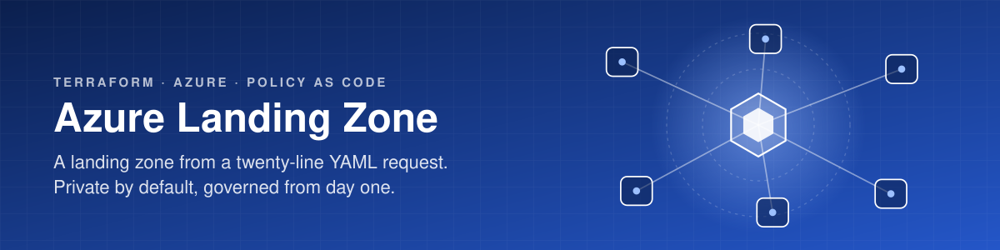
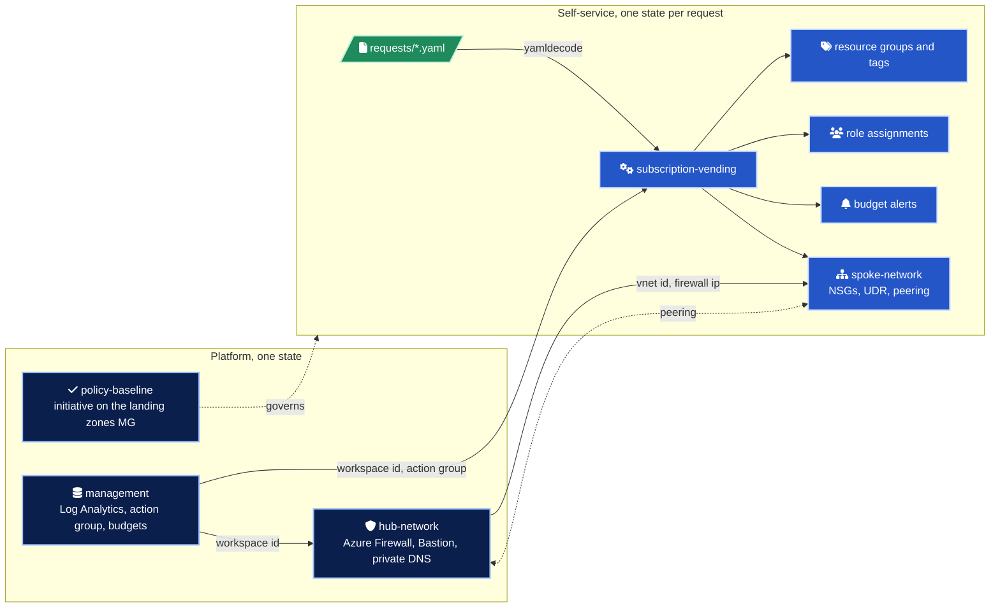
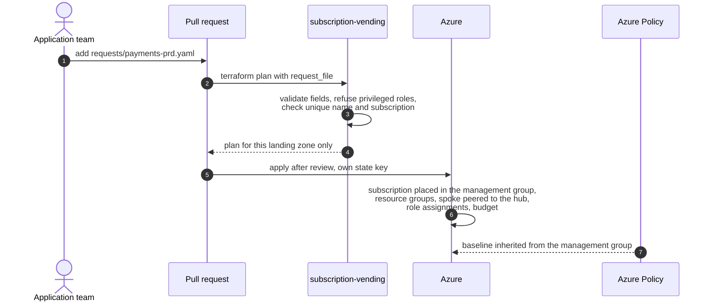
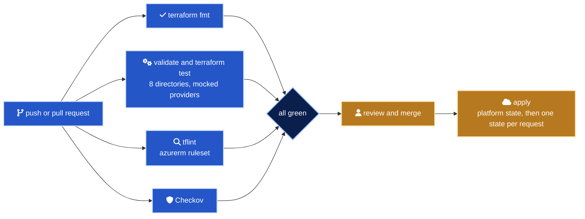

<div align="center">



# Azure Landing Zone in Terraform

Hub and spoke networking, policy as code and self-service subscription vending.<br>
A new landing zone is a twenty-line YAML file in a pull request, compliant on day one.

[](modules)
[](examples/full/versions.tf)
[](modules/policy-baseline/policies)
[](.github/workflows/ci.yml)
[](docs/adr/0003-private-by-default-networking.md)
[](LICENSE)

</div>

## In numbers

| | |
| ---: | --- |
| 5 | Terraform modules, plus a reusable diagnostic settings submodule |
| 35 | Resource blocks across the modules, each one typed and documented |
| 4 | Custom Azure Policy definitions in plain JSON, grouped in 1 initiative with 8 references |
| 16 | `terraform test` runs in 4 suites, plan-only with mocked providers, no credentials needed |
| 39 | Input validations that fail at plan time instead of at apply time |
| 12 | Private DNS zones for PaaS private endpoints, hosted once in the hub |
| 4 | CI jobs on every change: fmt, validate and test across 8 directories, tflint, Checkov |
| 4 | Architecture decision records |

## What it is

Most Azure estates do not fail on technology. They fail on the fiftieth subscription, each one built slightly differently, tagged by hand, with a public IP someone added "temporarily".

This repository encodes the opposite. The platform team owns a small set of modules and a policy baseline. Application teams ask for a landing zone with a YAML file in a pull request. Guardrails apply twice, at plan time through module validation and at runtime through Azure Policy, so even resources created outside Terraform are covered.

It follows the [Cloud Adoption Framework](https://learn.microsoft.com/azure/cloud-adoption-framework/ready/landing-zone/) design areas, trimmed on purpose to what a platform needs in its first year, and small enough to read in an afternoon.

## Architecture



| Module | What it builds | Key outputs |
| --- | --- | --- |
| [management](modules/management) | Log Analytics workspace with Entra-only auth, platform action group, subscription budgets, and the [diagnostic-settings](modules/management/modules/diagnostic-settings) submodule | `log_analytics_workspace_id`, `action_group_id`, `budget_ids` |
| [hub-network](modules/hub-network) | Hub VNet, Azure Firewall and policy (toggle), Bastion (toggle), gateway and shared subnets, 12 private DNS zones | `virtual_network_id`, `firewall_private_ip`, `firewall_policy_id`, `private_dns_zone_ids` |
| [spoke-network](modules/spoke-network) | Spoke VNet, one NSG per subnet with rules as data, route table to the firewall, two-sided peering across subscriptions | `virtual_network_id`, `subnet_ids`, `network_security_group_ids` |
| [policy-baseline](modules/policy-baseline) | Four custom definitions from JSON, one initiative, assignment at management group or subscription scope | `policy_set_definition_id`, `policy_assignment_id` |
| [subscription-vending](modules/subscription-vending) | Management group placement, resource groups, spoke, role assignments, budget and mandatory tags from one request object | `name_token`, `resource_group_ids`, `subnet_ids`, `tags` |

Every module README has the full input and output reference. Management groups, traffic flows and state boundaries are drawn in [docs/architecture.md](docs/architecture.md).

## From request to landing zone



A request describes what the team needs. The module decides how it is built.

```yaml
name: payments
environment: prd
location: westeurope
subscription_id: 11111111-1111-1111-1111-111111111111
management_group_id: /providers/Microsoft.Management/managementGroups/contoso-landingzones-corp
owner: team-payments@contoso.com
cost_center: cc-4100
data_classification: confidential

resource_groups: [app, data]

network:
  address_space: [10.110.0.0/22]
  subnets:
    app:  { address_prefixes: [10.110.0.0/24] }
    data: { address_prefixes: [10.110.1.0/26], private_endpoints: true }

role_assignments:
  - principal_id: bbbbbbbb-bbbb-bbbb-bbbb-bbbbbbbbbbbb
    role: Contributor
    scope: rg:app

budget:
  amount: 3500
  start_date: "2026-11-01T00:00:00Z"
  contact_emails: [team-payments@contoso.com]
```

## Two shapes, one codebase

| | [minimal](examples/minimal) | [full](examples/full) |
| --- | --- | --- |
| Purpose | Single sandbox subscription, near zero cost | Production shape, platform plus vended landing zones |
| Azure Firewall | Off | Premium, threat intelligence and IDPS in Deny, DNS proxy |
| Bastion | Off | Standard |
| Private DNS zones | 2 | 12 (module default) |
| Policy scope | Subscription | Landing zones management group |
| Policy mode | Report only (`enforce = false`) | Deny |
| Log retention | 30 days | 180 days, with platform budget and alert receivers |
| Landing zones | One spoke declared inline | Vended from `requests/*.yaml`, one state each |

## Quick start

You need Terraform 1.9 or later, the Azure CLI, and Contributor plus Resource Policy Contributor on a sandbox subscription. The minimal example takes the subscription from your current Azure CLI context.

```bash
git clone https://github.com/marlyngiselle/azure-landing-zone-terraform.git
cd azure-landing-zone-terraform/examples/minimal
az login
export TF_VAR_subscription_id="$(az account show --query id --output tsv)"
terraform init
terraform plan -out tfplan
terraform apply tfplan
```

Tear it down with `terraform destroy` in the same directory.

Run the checks exactly as CI does, from the repository root:

```bash
terraform fmt -check -recursive
for dir in modules/hub-network modules/spoke-network modules/policy-baseline modules/subscription-vending; do
  terraform -chdir="$dir" init -backend=false -input=false
  terraform -chdir="$dir" test
done
tflint --init && tflint --recursive --config "$PWD/.tflint.hcl"
checkov -d . --config-file .checkov.yaml
```

## Access and guardrails

Who can do what is decided in the request and enforced by the module before anything reaches Azure.

| Actor | Gets | Through |
| --- | --- | --- |
| Platform team | Changes to modules, hub, policy baseline | Platform state, reviewed pull request |
| Application team | Contributor (or narrower) on its own resource groups | `role_assignments` in its request, scoped `rg:<name>` |
| Anyone asking for Owner, User Access Administrator or RBAC Administrator | Nothing | Refused at plan time, privileged access is a platform change |
| Resources created outside Terraform | Same baseline | Azure Policy at the management group |

| Request | Result |
| --- | --- |
| `role: Owner` | Rejected at plan time |
| `scope: rg:shared` when `shared` is not a requested resource group | Rejected |
| `environment: production` | Rejected, only `dev`, `tst` or `prd` |
| `tags: { owner: someone@contoso.com }` | Ignored for mandatory tags, `owner` always comes from the request field |
| Two requests with the same name and environment, or the same subscription | Flagged by a `check` block on every run |

| Control | How |
| --- | --- |
| Egress | UDR `0.0.0.0/0` to the hub firewall, default outbound access off on every subnet |
| Inbound admin | Bastion in the hub, public IPs on NICs denied by policy |
| PaaS | Private endpoints, names resolved through the firewall DNS proxy against the hub zones |
| Logs | Log Analytics without shared keys, diagnostics set by the modules and audited by policy |
| Tags | The five tags the vending module sets are exactly the five the policy requires |

## Delivery



CI is fully automatic and needs no cloud credentials. Apply is outside this repository on purpose. The [full example](examples/full/README.md) shows the loop that applies each request with its own backend key.

## Before you touch anything

> [!CAUTION]
> The policy baseline defaults to `Deny`. Assigned to a management group that already holds workloads, it blocks deployments that were fine yesterday. In brownfield scopes, start with `Audit` effects or `enforce = false`, remediate, then switch to `Deny` ([ADR 0002](docs/adr/0002-policy-as-code-with-custom-definitions.md)).

> [!WARNING]
> The full example deploys Azure Firewall Premium and Bastion Standard, which bill by the hour from the moment they exist. Use the minimal example to explore.

> [!IMPORTANT]
> Subscription vending lands an existing subscription, it does not create one. Creation through billing aliases depends on the agreement type and belongs in a separate, tightly permissioned step ([ADR 0004](docs/adr/0004-subscription-vending-from-requests.md)).

> [!NOTE]
> Modules that declare `configuration_aliases` cannot be validated as a root. CI validates them through the examples and exercises them with `terraform test`.

## Design principles

| Principle | In practice |
| --- | --- |
| Secure by default | Firewall on, threat intelligence in Deny, an NSG on every workload subnet, egress forced through the hub. Opting out is explicit and visible in review |
| Policy as code | Definitions are plain Azure Policy JSON. Effects are initiative parameters, so a control moves from Audit to Deny with a one-line change |
| Self-service with guardrails | Requests are validated field by field, and each landing zone has its own state, so a change to one never plans against another |
| Boring, explicit interfaces | Modules take IDs and return IDs. No lookups by name across subscriptions. Cross-subscription work uses an explicit `azurerm.hub` provider alias |
| Verified continuously | Every Checkov suppression (3 in total) sits next to its resource with the justification |

## Repository map

| Path | Role |
| --- | --- |
| [`modules/management`](modules/management) | Log Analytics, action group, budgets, diagnostic settings submodule |
| [`modules/hub-network`](modules/hub-network) | Hub VNet, firewall, Bastion, private DNS |
| [`modules/spoke-network`](modules/spoke-network) | Spoke VNet, NSGs, UDR, peering |
| [`modules/policy-baseline`](modules/policy-baseline) | Initiative and [`policies/*.json`](modules/policy-baseline/policies) |
| [`modules/subscription-vending`](modules/subscription-vending) | Request object to landing zone |
| [`examples/minimal`](examples/minimal) | Single sandbox subscription |
| [`examples/full`](examples/full) | Platform plus vending, with [`requests/*.yaml`](examples/full/requests) |
| [`docs`](docs) | Architecture, naming and tagging, ADRs |
| [`.github/workflows/ci.yml`](.github/workflows/ci.yml) | fmt, validate, test, tflint, Checkov |

## Documentation

| Document | Covers |
| --- | --- |
| [Architecture](docs/architecture.md) | Management group layout, network topology, traffic flows, module composition, scope limits |
| [Naming and tagging](docs/naming-and-tagging.md) | Name tokens, type prefixes, region codes, mandatory tags and where they come from |
| [ADR 0001](docs/adr/0001-hub-and-spoke-with-azure-firewall.md) | Hub and spoke with Azure Firewall rather than Virtual WAN |
| [ADR 0002](docs/adr/0002-policy-as-code-with-custom-definitions.md) | Policy as code with JSON definitions and parameterised effects |
| [ADR 0003](docs/adr/0003-private-by-default-networking.md) | Private by default networking |
| [ADR 0004](docs/adr/0004-subscription-vending-from-requests.md) | Subscription vending from YAML requests, one state per landing zone |

<details>
<summary>Roadmap</summary>

- [ ] Multi-region hub with a second firewall and cross-region peering
- [ ] Azure Monitor baseline alerts for firewall health and VNet gateway
- [ ] More policy controls, such as denying public network access on PaaS, requiring TLS 1.2 and Defender for Cloud plans
- [ ] Subscription creation through billing aliases as a separate, tightly permissioned stage
- [ ] Generated module documentation with terraform-docs in CI
- [ ] Release tags per module and a pinned module source in the examples

</details>

<div align="center">
<br>
<sub>MIT licensed · © 2026 Giselle Da Costa</sub>
</div>
