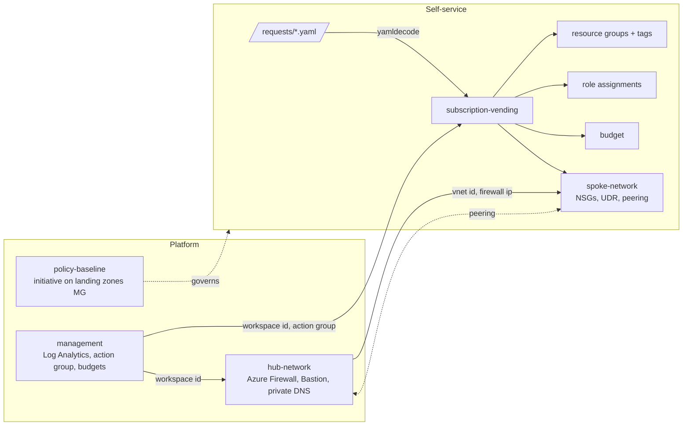

# Azure Landing Zone in Terraform

[](https://github.com/marlyngiselle/azure-landing-zone-terraform/actions/workflows/ci.yml)


[](LICENSE)

An opinionated, modular Azure landing zone: hub and spoke networking, policy as code, and self-service subscription vending driven by YAML requests. Secure by default, small enough to read in an afternoon, structured to grow into an enterprise platform.

```text
requests/payments-prd.yaml  ──►  subscription in the right management group
                                 resource groups with names and tags that pass policy
                                 spoke VNet peered to the hub, egress through the firewall
                                 least-privilege role assignments
                                 monthly budget with forecast alerts
```

## Why this exists

Most Azure estates do not fail on technology. They fail on the fiftieth subscription: each one built slightly differently, tagged by hand, with a public IP someone added "temporarily". This repository encodes the opposite approach:

- The platform team owns a small set of modules and a policy baseline.
- Application teams ask for a landing zone with a twenty-line YAML file in a pull request.
- Guardrails are enforced twice: at plan time by module validation, and at runtime by Azure Policy, so even resources created outside Terraform are covered.

It follows the [Cloud Adoption Framework](https://learn.microsoft.com/azure/cloud-adoption-framework/ready/landing-zone/) design areas, deliberately trimmed to what a platform needs in its first year.

## Architecture



More diagrams (management groups, traffic flows, state boundaries) in [docs/architecture.md](docs/architecture.md).

## Quick start

Prerequisites: Terraform 1.9 or later, the Azure CLI signed in (`az login`), and Contributor plus Resource Policy Contributor on a sandbox subscription.

```bash
git clone https://github.com/marlyngiselle/azure-landing-zone-terraform.git
cd azure-landing-zone-terraform/examples/minimal

cp terraform.tfvars.example terraform.tfvars
# edit terraform.tfvars and set subscription_id

terraform init
terraform plan -out tfplan
terraform apply tfplan
```

The minimal example deploys Log Analytics, a hub without firewall, one spoke and the policy baseline in report-only mode. For the production shape (firewall Premium, Bastion, management group policy, vending from YAML), see [examples/full](examples/full).

Run the checks locally exactly as CI does:

```bash
terraform fmt -check -recursive
tflint --init && tflint --recursive --config "$PWD/.tflint.hcl"
(cd modules/subscription-vending && terraform init -backend=false && terraform test)
checkov -d . --config-file .checkov.yaml
```

## Modules

| Module | What it builds | Key inputs | Key outputs |
|--------|----------------|------------|-------------|
| [management](modules/management) | Log Analytics workspace (Entra-only auth), platform action group, subscription budgets, plus a reusable [diagnostic-settings](modules/management/modules/diagnostic-settings) submodule | `name`, `log_analytics`, `alert_email_receivers`, `budgets` | `log_analytics_workspace_id`, `action_group_id`, `budget_ids` |
| [hub-network](modules/hub-network) | Hub VNet, Azure Firewall and policy (toggle), Bastion (toggle), gateway and shared subnets, 12 private DNS zones for PaaS | `address_space`, `subnets`, `firewall`, `bastion`, `private_dns_zones` | `virtual_network_id`, `firewall_private_ip`, `firewall_policy_id`, `private_dns_zone_ids` |
| [spoke-network](modules/spoke-network) | Spoke VNet, subnets with one NSG each, rules as data, route table to the firewall, two-sided peering across subscriptions | `address_space`, `subnets`, `hub` | `virtual_network_id`, `subnet_ids`, `network_security_group_ids` |
| [policy-baseline](modules/policy-baseline) | Four custom definitions from JSON, one initiative, assignment at management group or subscription scope | `scope`, `allowed_locations`, `required_tags`, `effects`, `assignment` | `policy_set_definition_id`, `policy_assignment_id` |
| [subscription-vending](modules/subscription-vending) | Management group placement, resource group layout, spoke, role assignments, budget and mandatory tags from one request object | `request`, `hub`, `log_analytics_workspace_id` | `name_token`, `resource_group_ids`, `subnet_ids`, `tags` |

Every module README has the full input and output reference. Every variable is typed, documented and validated where a wrong value would only fail at apply time.

## A landing zone request

```yaml
name: payments
environment: prd
location: westeurope
subscription_id: 11111111-1111-1111-1111-111111111111
management_group_id: /providers/Microsoft.Management/managementGroups/contoso-landingzones-corp
owner: team-payments@contoso.com
cost_center: cc-4100
data_classification: confidential

resource_groups: [app, data]

network:
  address_space: [10.110.0.0/22]
  subnets:
    app:  { address_prefixes: [10.110.0.0/24] }
    data: { address_prefixes: [10.110.1.0/26], private_endpoints: true }

role_assignments:
  - principal_id: bbbbbbbb-bbbb-bbbb-bbbb-bbbbbbbbbbbb
    role: Contributor
    scope: rg:app

budget:
  amount: 3500
  start_date: "2026-11-01T00:00:00Z"
  contact_emails: [team-payments@contoso.com]
```

What the module refuses at plan time, before anything reaches Azure:

| Request | Result |
|---------|--------|
| `role: Owner` (or User Access Administrator, RBAC Administrator) | Rejected: privileged access is a platform change, not self-service |
| `scope: rg:shared` when `shared` is not a requested resource group | Rejected |
| `environment: production` | Rejected: `dev`, `tst` or `prd` |
| `tags: { owner: someone@contoso.com }` | Ignored for mandatory tags: `owner` always comes from the request field |
| Two request files with the same name and environment, or the same subscription | Flagged by a `check` block on every run |

## Design principles

**Secure by default.** Firewall on, threat intelligence in Deny, default outbound access off on every subnet, an NSG on every workload subnet, egress forced through the hub, Log Analytics without shared keys, no public IPs on NICs. Opting out is explicit and visible in review.

**Policy as code.** Definitions are plain Azure Policy JSON in the repository. Effects are initiative parameters, so a control moves from Audit to Deny with a one-line change. The tags the vending module sets are exactly the tags the policy requires, so new landing zones are compliant on day one.

**Self-service with guardrails.** Teams describe what they need; modules decide how it is built. Requests are validated field by field, and each landing zone has its own state so a change to one never plans against another.

**Boring, explicit interfaces.** Modules take IDs and return IDs. No data source lookups by name across subscriptions, no hidden coupling. Cross-subscription operations use an explicit `azurerm.hub` provider alias.

**Verified continuously.** CI runs `terraform fmt`, `terraform validate` on every module and example, plan-only `terraform test` suites with mocked providers (no credentials needed), tflint with the azurerm ruleset, and Checkov. Every Checkov suppression sits next to the resource with its justification.

## Repository layout

```text
.
├── modules/
│   ├── management/                  # Log Analytics, action group, budgets
│   │   └── modules/diagnostic-settings/
│   ├── hub-network/                 # hub VNet, firewall, Bastion, private DNS
│   ├── spoke-network/               # spoke VNet, NSGs, UDR, peering
│   ├── policy-baseline/             # initiative + policies/*.json
│   └── subscription-vending/        # request object -> landing zone
├── examples/
│   ├── minimal/                     # single sandbox subscription
│   └── full/                        # platform + vending, requests/*.yaml
├── docs/
│   ├── architecture.md
│   ├── naming-and-tagging.md
│   └── adr/                         # architecture decision records
└── .github/workflows/ci.yml
```

## Design decisions

| ADR | Decision |
|-----|----------|
| [0001](docs/adr/0001-hub-and-spoke-with-azure-firewall.md) | Hub and spoke with Azure Firewall rather than Virtual WAN |
| [0002](docs/adr/0002-policy-as-code-with-custom-definitions.md) | Policy as code with JSON definitions and parameterised effects |
| [0003](docs/adr/0003-private-by-default-networking.md) | Private by default: forced egress, no public IPs on NICs, central private DNS |
| [0004](docs/adr/0004-subscription-vending-from-requests.md) | Subscription vending from YAML requests, one state per landing zone |

Naming and tagging conventions: [docs/naming-and-tagging.md](docs/naming-and-tagging.md).

## Roadmap

- [ ] Multi-region hub with a second firewall and cross-region peering
- [ ] Azure Monitor baseline alerts for firewall health and VNet gateway
- [ ] Additional policy controls: deny public network access on PaaS, require TLS 1.2, Defender for Cloud plans
- [ ] Subscription creation through billing aliases as a separate, tightly permissioned stage
- [ ] Generated module documentation with terraform-docs in CI
- [ ] Release tags per module and a pinned module source in the examples

## License

[MIT](LICENSE) © 2026 Giselle Da Costa
