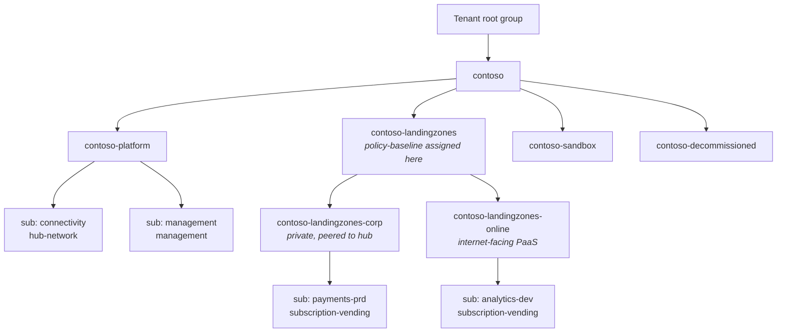
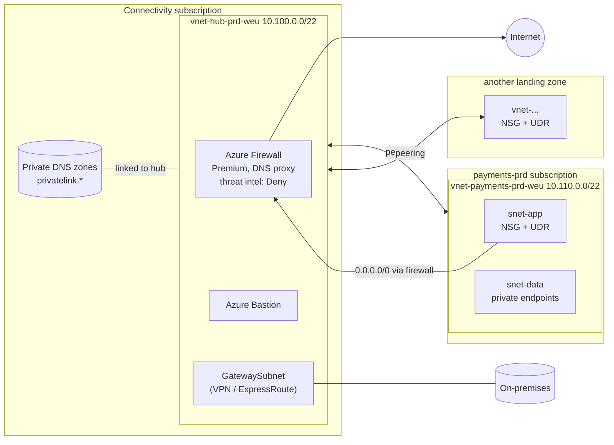
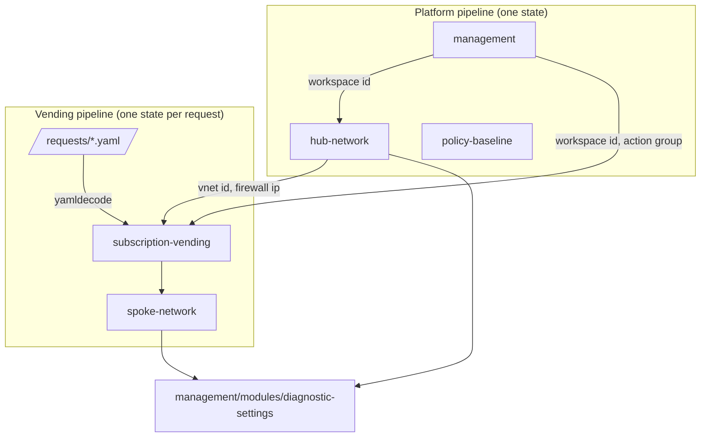

# Architecture

This landing zone follows the Cloud Adoption Framework design areas, with a deliberately small surface: what most organisations need in their first year on Azure, built so it can grow without a rewrite.

## Management group and subscription layout

The management group hierarchy itself is a one-off, tenant-level bootstrap and is not part of these modules. The modules take management group IDs as inputs so they work with any hierarchy.

## Network topology

Traffic rules that fall out of this design:

| Flow | Path |
|------|------|
| Spoke to internet | UDR `0.0.0.0/0` to the firewall, SNAT on the firewall public IP. Default outbound access is disabled on every subnet, so there is no other way out. |
| Spoke to spoke | Through the firewall (no transitive peering), so east-west traffic is inspected and logged. |
| Spoke to PaaS | Private endpoint in the spoke, name resolved by the firewall DNS proxy against the private DNS zones linked to the hub. |
| Admin access to VMs | Bastion in the hub. Public IPs on NICs are denied by policy. |
| On-premises | Gateway in the hub, `use_remote_gateways` opt in per spoke. |

## Module composition

Two lifecycles, two pipelines: the platform changes rarely and is owned by the platform team; landing zones change often and are requested by application teams. Splitting state along that line keeps the blast radius of a landing zone change to that landing zone.

## What is intentionally out of scope

- Management group hierarchy bootstrap and tenant-level settings.
- Subscription creation (billing-agreement specific, see [ADR 0004](adr/0004-subscription-vending-from-requests.md)).
- Identity: Entra ID groups and workload identities are created upstream; requests reference them by object ID.
- Firewall rule collection groups: owned by the teams that own the flows, attached to the exported `firewall_policy_id`.
